<!--

I am **DevOps Engineer** living in **Prague, Czechia** 🇨🇿

🌍 Never exploring, always lost.
-->

<picture>
  <source media="(prefers-color-scheme: dark)" srcset="assets/kubectl-dark.svg">
  <source media="(prefers-color-scheme: light)" srcset="assets/kubectl-light.svg">
  
</picture>
